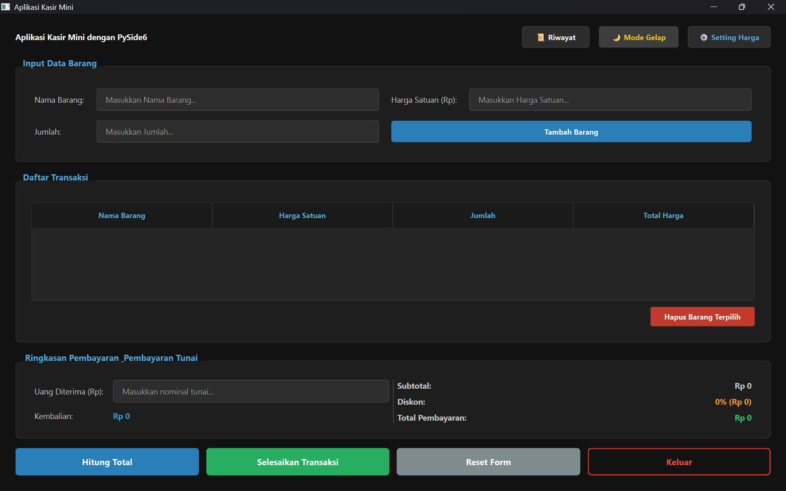
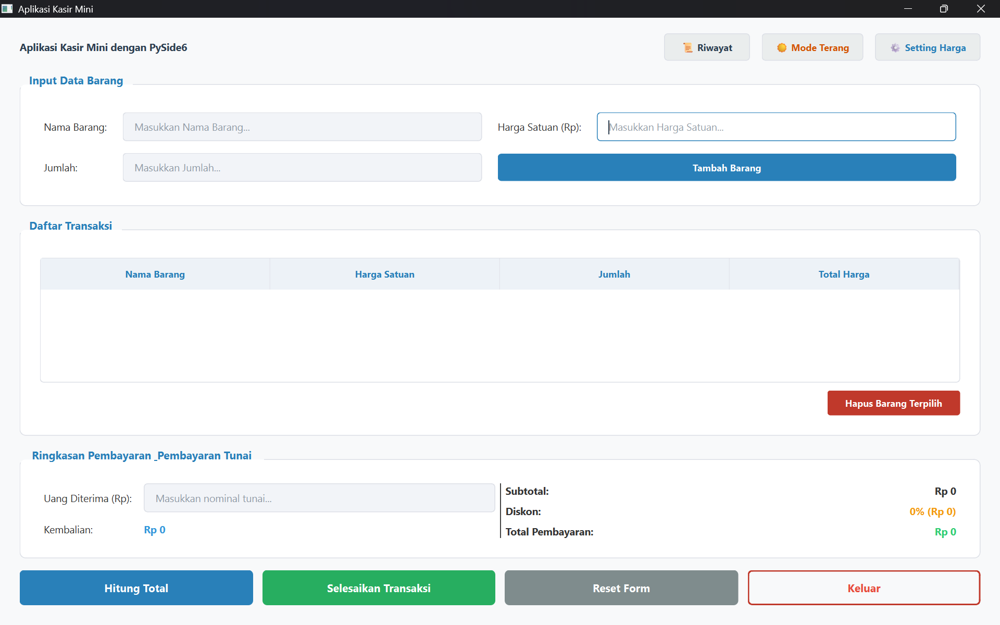
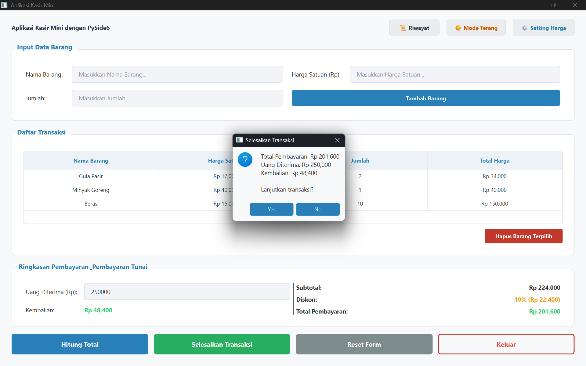
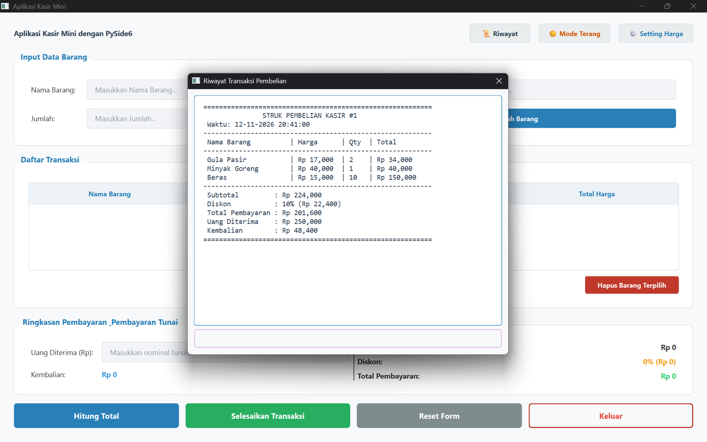
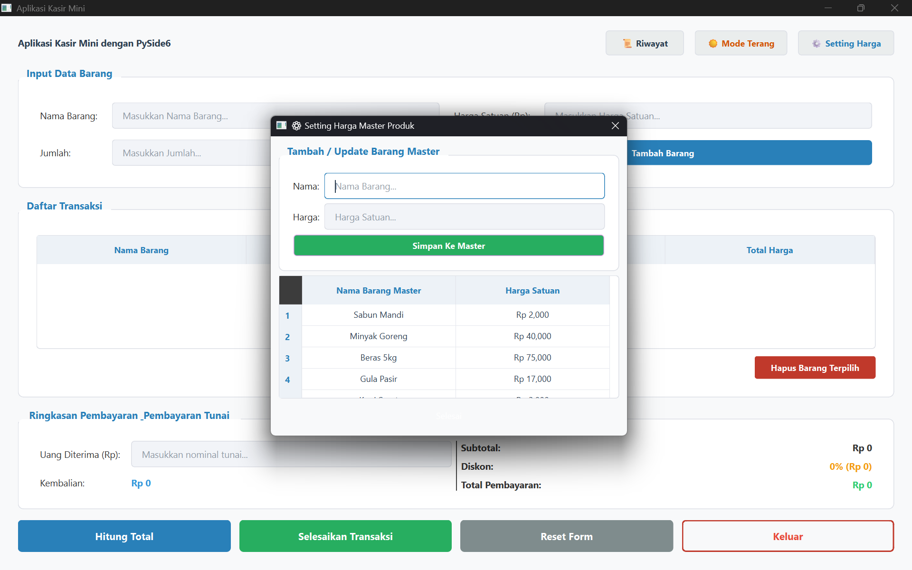

# Aplikasi Kasir Mini Berbasis Desktop
**Tugas Ujian Tengah Semester (UTS) - Pemrograman Visual - Megatama Setiaji - 312410356**

Aplikasi Kasir Mini ini dibangun menggunakan bahasa pemrograman Python dengan pustaka antarmuka pengguna (GUI) **PySide6**. Aplikasi ini dirancang untuk dijalankan di Virtual Environment agar dependensinya tetap terisolasi dan rapi tanpa mengganggu Sistem Operasi.

---

## 📸 Tampilan Antarmuka Aplikasi

Aplikasi mendukung mode terang dan mode gelap, serta dilengkapi dengan fitur riwayat transaksi, pengaturan harga master, dan kalkulator kembalian.

### 1. Tampilan Utama (Mode Gelap)


### 2. Tampilan Utama (Mode Terang)


### 3. Simulasi Transaksi (Perhitungan & Diskon)


### 4. Konfirmasi Penyelesaian Transaksi


### 5. Riwayat Struk Digital


### 6. Setting Master Harga (Auto-Complete)


---

## 📋 Prasyarat Sistem
Sebelum menjalankan aplikasi, pastikan sistem Anda telah terpasang:
* **Python**
* Koneksi internet (hanya untuk mengunduh library)

---

## 🚀 Cara Menjalankan Aplikasi

Langkah-langkah di bawah ini dibedakan berdasarkan Sistem Operasi yang digunakan. Silakan ikuti panduan sesuai dengan OS Anda (Windows atau Linux/macOS).

### 1. Membuka Terminal / Command Prompt
Buka terminal dan arahkan masuk ke dalam folder proyek (folder yang berisi file `main.py`).
```bash
cd "path/ke/folder/Pertemuan 8 - UTS/pertemuan-8"
```

### 2. Membuat Virtual Environment
Membuat ruang virtual (`env`) untuk mengisolasi pustaka proyek ini.

* **Untuk Windows:**
  ```cmd
  python -m venv pvd
  ```
* **Untuk Linux / macOS:**
  ```bash
  python3 -m venv pvd
  ```

### 3. Mengaktifkan Virtual Environment
Setelah dibuat, ruang virtual harus diaktifkan sebelum menginstal library.

* **Untuk Windows (Command Prompt / CMD):**
  ```cmd
  .\pvd\Scripts\activate.bat
  ```
* **Untuk Windows (PowerShell):**
  ```powershell
  .\pvd\Scripts\Activate.ps1
  ```
  *(Catatan: Jika muncul error `UnauthorizedAccess` di PowerShell Windows, jalankan perintah `Set-ExecutionPolicy -ExecutionPolicy Bypass -Scope Process` lalu coba tekan enter, kemudian ulangi perintah aktivasi di atas).*
  
* **Untuk Linux / macOS:**
  ```bash
  source pvd/bin/activate
  ```
> **Ciri Virtual Environment Aktif:** Akan muncul tulisan `(pvd)` di awal baris terminal Anda.

### 4. Menginstal Library (PySide6)
Setelah virtual environment aktif `(pvd)`, perbarui `pip` dan instal library yang dibutuhkan (PySide6).

* **Windows / Linux / macOS:**
  ```bash
  pip install PySide6
  ```
  *Atau bisa melalui file `requirements.txt` yang sudah disediakan, cukup jalankan:*
  ```bash
  pip install -r requirements.txt
  ```

### 5. Menjalankan Aplikasi
Setelah instalasi library selesai, aplikasi kasir mini siap untuk dijalankan.

* **Untuk Windows:**
  ```cmd
  python main.py
  ```
* **Untuk Linux / macOS:**
  ```bash
  python main.py
  ```

---

## 🛠️ Fitur Utama Aplikasi
1. **Perhitungan Otomatis:** Subtotal, Diskon, Total Bayar, dan Kembalian dihitung secara *real-time* (*event-driven*).
2. **Katalog Master Harga:** Fitur auto-complete dan auto-fill harga satuan ketika mengetik nama barang. Terdapat pop-up khusus (⚙️ Setting Harga) untuk menambah daftar katalog.
3. **Validasi Input:** 
   - Nama barang hanya bisa diisi huruf.
   - Harga dan jumlah hanya bisa diisi angka bilangan bulat.
   - Peringatan keamanan (*konfirmasi dialog*) sebelum menghapus barang, mereset form, menyewa setruk, atau keluar aplikasi.
4. **Riwayat Pembelian:** Transaksi yang diselesaikan akan direkam layaknya struk kasir nyata.
5. **Tema Dinamis:** Beralih antara mode Terang (☀️) dan Gelap (🌙) hanya dengan satu klik tanpa me-reset form.

---
*AjiThomthom.*